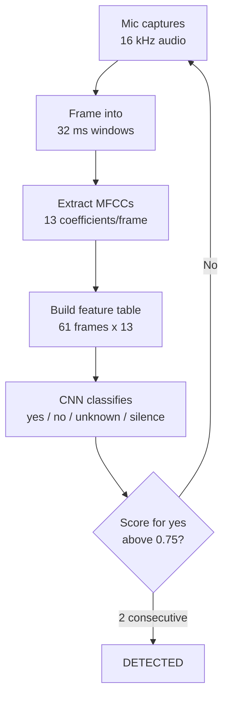

import TawkWidget from '../../../../components/TawkWidget.astro';
import UniversalContentContributors from '../../../../components/UniversalContentContributors.astro';
import InArticleAd from '../../../../components/InArticleAd.astro';
import Copyright from '../../../../components/Copyright.astro';
import BionicText from '../../../../components/BionicText.astro';
import TailwindWrapper from '../../../../components/TailwindWrapper.jsx';
import { Tabs, TabItem } from '@astrojs/starlight/components';
import { Card, CardGrid, Badge, Steps, LinkButton, FileTree } from '@astrojs/starlight/components';

<UniversalContentContributors 
  contributors={frontmatter.contributors}
/>


import EdgeAiTinymlComments from '../../../../components/edge-ai-tinyml/EdgeAiTinymlComments.astro';

import PodcastEmbed from '../../../../components/PodcastEmbed.astro';

A device that reacts to a spoken word must listen all the time. If it sends everything it hears to a server, it uses the network without pause, it answers late, and every conversation near it leaves the room. A wake word detector avoids all three. It listens on the microcontroller, classifies one second of sound at a time, and acts only when it hears its word. This lesson builds one: the microphone wiring, the capture firmware, the feature extraction that turns sound into numbers a small model can use, the training, and the loop that lights an LED and publishes a message. #KeywordSpotting #TinyML #ESP32

<PodcastEmbed src="https://open.spotify.com/episode/7iMHvUA2R84z83DVNuBxZ3?si=4El8yOw9SwuDoMZQhDHc1Q" />

## What We Are Building

<Card title="Wake Word Detector" icon="star">
A trigger that listens for the word "yes" (from Google's Speech Commands dataset) with an INMP441 digital microphone connected to an ESP32. When the model reports the word with a score above a threshold, the ESP32 lights an LED and can publish an MQTT message. All inference runs on the MCU, with no server.
</Card>

**Project specifications:**

| Parameter | Value |
|-----------|-------|
| MCU | ESP32 DevKitC |
| Microphone | INMP441 I2S MEMS |
| Audio format | 16 kHz, 16-bit mono |
| Window length | 1 second (16000 samples) |
| Feature extraction | 13 MFCCs, 32 ms frames, 16 ms hop |
| Model | Small CNN (Conv1D), about 41 KB quantized |
| Classes | "yes", "no", "unknown", "silence" |
| Inference time | < 100 ms on ESP32 at 240 MHz |
| Detection LED | GPIO 2 (onboard) |
| MQTT topic | device/wakeword/detected |

### Bill of Materials

| Ref | Component | Quantity | Notes |
|-----|-----------|----------|-------|
| U1 | ESP32 DevKitC | 1 | Reuse from previous lessons |
| M1 | INMP441 I2S MEMS microphone breakout | 1 | I2S output, 3.3V compatible |
| | Breadboard + jumper wires | 1 set | |

## Audio ML on Microcontrollers

<InArticleAd />


Sound classification on a microcontroller has three stages. A digital microphone delivers samples. Feature extraction reduces each second of samples to a small table of numbers that says which frequencies were strong at which moment. A small neural network then chooses a class from that table.



The firmware of this lesson records one second, classifies it, and records the next second:

```text
  Audio stream (continuous):
  ──────────────────────────────────────────────►
  ├── 1 s window ──┼── 1 s window ──┼── 1 s window ──┤
          │                │                │
          ▼                ▼                ▼
      classify         classify         classify

  score for "yes" above 0.75 in 2 windows in a row
  ──► DETECTED
```

The limits on an ESP32:
- RAM: about 520 KB. The audio buffer (32 KB), the feature table (about 3 KB) and the tensor arena (40 KB reserved) share it. The weights stay in flash.
- Flash: up to 4 MB, shared by the quantized model and the firmware.
- CPU: two cores at 240 MHz. The computing for one second of sound must take less than one second, or the device falls behind.

We sample at 16 kHz because the Speech Commands dataset is recorded at that rate. It can represent frequencies up to 8 kHz, half the rate, and the parts of speech that distinguish words lie below that.

## I2S Microphone Hardware Setup

<InArticleAd />


The INMP441 is a MEMS microphone (a microphone etched in silicon) with a digital output. It sends its samples over I2S, a three-wire serial bus made for audio. The I2S peripheral of the ESP32 reads them directly, so no analog-to-digital converter (ADC) and no amplifier are needed.

### Wiring

| ESP32 Pin | INMP441 Pin | Notes |
|-----------|-------------|-------|
| GPIO 26 | WS (Word Select) | Left/right channel select |
| GPIO 25 | SCK (Serial Clock) | Bit clock |
| GPIO 33 | SD (Serial Data) | Audio data output |
| 3.3V | VDD | Power supply |
| GND | GND | Common ground |
| GND | L/R | Tie to GND for left channel |

The L/R pin selects the channel on which the microphone sends. Connected to GND it sends on the left channel, and connected to VDD on the right. With one microphone, the left channel is the usual choice.

### Why I2S Instead of Analog?

An analog electret microphone on the ADC of the ESP32 needs an amplifier circuit, and the 12-bit ADC adds noise. The INMP441 sends 24-bit samples, filters out frequencies too high for the sample rate, and has a signal-to-noise ratio (SNR) of 61 dBA. A model classifies clean sound more accurately, so the I2S microphone is the better choice.

## Audio Capture Firmware

<InArticleAd />


The following ESP-IDF code configures the I2S peripheral and captures 1-second windows of sound into a buffer.

### I2S Configuration and Capture

```c
#include <stdio.h>
#include <string.h>
#include <math.h>
#include "freertos/FreeRTOS.h"
#include "freertos/task.h"
#include "driver/i2s_std.h"
#include "esp_log.h"
#include "esp_timer.h"

static const char *TAG = "wake_word";

/* Audio parameters */
#define SAMPLE_RATE       16000
#define SAMPLE_BITS       I2S_DATA_BIT_WIDTH_16BIT
#define CHANNEL           I2S_SLOT_MODE_MONO
#define AUDIO_WINDOW_SEC  1
#define AUDIO_BUFFER_LEN  (SAMPLE_RATE * AUDIO_WINDOW_SEC)

/* I2S GPIO pins */
#define I2S_WS_PIN   26
#define I2S_SCK_PIN  25
#define I2S_SD_PIN   33

/* Detection */
#define DETECTION_THRESHOLD  0.75f
#define LED_PIN              GPIO_NUM_2

static i2s_chan_handle_t s_rx_chan = NULL;
static int16_t s_audio_buffer[AUDIO_BUFFER_LEN];

/* ---- I2S initialization ---- */

static void i2s_init(void)
{
    i2s_chan_config_t chan_cfg = I2S_CHANNEL_DEFAULT_CONFIG(
        I2S_NUM_0, I2S_ROLE_MASTER);
    chan_cfg.dma_desc_num = 8;
    chan_cfg.dma_frame_num = 512;

    ESP_ERROR_CHECK(i2s_new_channel(&chan_cfg, NULL, &s_rx_chan));

    i2s_std_config_t std_cfg = {
        .clk_cfg = I2S_STD_CLK_DEFAULT_CONFIG(SAMPLE_RATE),
        .slot_cfg = I2S_STD_PHILIPS_SLOT_DEFAULT_CONFIG(
            I2S_DATA_BIT_WIDTH_32BIT, I2S_SLOT_MODE_MONO),
        .gpio_cfg = {
            .mclk = I2S_GPIO_UNUSED,
            .bclk = (gpio_num_t)I2S_SCK_PIN,
            .ws   = (gpio_num_t)I2S_WS_PIN,
            .dout = I2S_GPIO_UNUSED,
            .din  = (gpio_num_t)I2S_SD_PIN,
            .invert_flags = {
                .mclk_inv = false,
                .bclk_inv = false,
                .ws_inv   = false,
            },
        },
    };

    ESP_ERROR_CHECK(i2s_channel_init_std_mode(s_rx_chan, &std_cfg));
    ESP_ERROR_CHECK(i2s_channel_enable(s_rx_chan));

    ESP_LOGI(TAG, "I2S initialized: %d Hz, mono, 32-bit frames", SAMPLE_RATE);
}

/* ---- Audio capture ---- */

static esp_err_t capture_audio_window(int16_t *out_buf, size_t num_samples)
{
    /* The INMP441 outputs 32-bit frames; we read raw and extract 16-bit */
    int32_t raw_samples[512];
    size_t bytes_read = 0;
    size_t samples_collected = 0;

    while (samples_collected < num_samples) {
        size_t to_read = 512;
        if (samples_collected + to_read > num_samples) {
            to_read = num_samples - samples_collected;
        }

        esp_err_t ret = i2s_channel_read(s_rx_chan, raw_samples,
                                          to_read * sizeof(int32_t),
                                          &bytes_read,
                                          pdMS_TO_TICKS(1000));
        if (ret != ESP_OK) {
            ESP_LOGE(TAG, "I2S read error: %s", esp_err_to_name(ret));
            return ret;
        }

        size_t got = bytes_read / sizeof(int32_t);
        for (size_t i = 0; i < got; i++) {
            /* Shift down from 24-bit left-justified to 16-bit */
            out_buf[samples_collected + i] = (int16_t)(raw_samples[i] >> 16);
        }
        samples_collected += got;
    }

    return ESP_OK;
}
```

The INMP441 puts each 24-bit sample at the top of a 32-bit I2S frame. We read the 32-bit values and shift them right by 16 to keep the top 16 bits, which gives a signed 16-bit sample.

The microphone does not stop while the processor computes. The I2S driver therefore receives through DMA (direct memory access, hardware that stores incoming data without the CPU) into 8 buffers of 512 samples. They hold 256 ms of sound, which covers the time spent on feature extraction and inference. One second of sound is 16000 samples, or 32 KB as int16.

## Feature Extraction: MFCC on Device

<InArticleAd />


A small model cannot learn from the raw samples. One second is 16000 numbers, and the same word spoken twice differs at almost every sample, because the timing never repeats exactly. What repeats is the pattern of strong and weak frequencies over time, as sheet music records which notes are played when, not the air pressure. Feature extraction computes that pattern: it cuts the second into 61 overlapping frames and describes each by 13 numbers called MFCCs (mel-frequency cepstral coefficients). The model receives 793 numbers in place of 16000, and they change little when the word comes a little earlier or louder.

### MFCC Pipeline

Each frame of 512 samples (32 ms) goes through six steps:

1. Pre-emphasis. Speech is weaker at high frequencies, where the consonants are. A simple filter raises them: `y[n] = x[n] - 0.97 * x[n-1]`.
2. Windowing. The frame is multiplied by a Hann window, a curve that fades it in and out, so that its cut ends do not appear as false frequencies.
3. FFT. A 512-point fast Fourier transform gives the strength of 257 frequencies in the frame.
4. Mel filterbank. The 257 values are added into 26 bands. The bands are narrow at low frequencies and wide at high ones, as in human hearing (the mel scale).
5. Log energy. The logarithm of each band is taken. A louder voice then only adds the same amount to every band, and the pattern stays the same.
6. DCT. A discrete cosine transform describes the shape of the 26 band values, and the first 13 of its outputs are kept. These are the MFCCs.

### C Implementation

The firmware must compute the features exactly as the training script does: the same sample scale, window, log floor and DCT. If one step differs, the model receives numbers it was never trained on. Two parts of this listing are placeholders that you replace: the filterbank table and the FFT.

```c
/* MFCC parameters */
#define FRAME_LEN      512      /* 32 ms at 16 kHz */
#define FRAME_STEP     256      /* 16 ms hop (50% overlap) */
#define NUM_MFCC       13
#define NUM_MEL_BINS   26
#define FFT_SIZE       512
#define NUM_FRAMES     ((AUDIO_BUFFER_LEN - FRAME_LEN) / FRAME_STEP + 1)

/* Pre-computed mel filterbank (stored in flash) */
static const float MEL_FILTERBANK[NUM_MEL_BINS][FFT_SIZE / 2 + 1] = {
    /* These values are generated by the Python script below.
       Each row is a triangular filter spanning the FFT bins
       corresponding to the mel-spaced center frequencies.
       For brevity, we show the structure; the actual values
       are generated and pasted from the training script. */
    {0.0f}, /* placeholder, see generate_filterbank.py */
};

/* Hann window (pre-computed) */
static float s_hann_window[FRAME_LEN];

static void precompute_hann_window(void)
{
    for (int i = 0; i < FRAME_LEN; i++) {
        /* Periodic Hann window, the same one tf.signal.stft uses */
        s_hann_window[i] = 0.5f * (1.0f - cosf(2.0f * M_PI * i
                                                  / FRAME_LEN));
    }
}

/* Simplified FFT magnitude (in-place, radix-2 decimation-in-time) */
static void fft_magnitude(const float *input, float *magnitude, int n)
{
    /* For production, use esp-dsp library's dsps_fft2r_fc32.
       This placeholder shows the interface. */
    float real[FFT_SIZE];
    float imag[FFT_SIZE];

    memcpy(real, input, n * sizeof(float));
    memset(imag, 0, n * sizeof(float));

    /* Use ESP-DSP FFT for performance:
       #include "dsps_fft2r.h"
       dsps_fft2r_init_fc32(NULL, FFT_SIZE);
       dsps_fft2r_fc32(real, FFT_SIZE);
       dsps_bit_rev_fc32(real, FFT_SIZE);
    */

    for (int i = 0; i <= n / 2; i++) {
        magnitude[i] = sqrtf(real[i] * real[i] + imag[i] * imag[i]);
    }
}

/* Extract MFCCs for the entire audio window */
static void extract_mfcc(const int16_t *audio, float mfcc_out[][NUM_MFCC])
{
    float frame[FRAME_LEN];
    float magnitude[FFT_SIZE / 2 + 1];
    float mel_energy[NUM_MEL_BINS];
    float dct_input[NUM_MEL_BINS];

    for (int f = 0; f < NUM_FRAMES; f++) {
        int offset = f * FRAME_STEP;

        /* Pre-emphasis and windowing. Samples are scaled to [-1, 1],
           the same scale the training script gets from decode_wav. */
        for (int i = 0; i < FRAME_LEN; i++) {
            int n = offset + i;
            float prev = (n > 0) ? (float)audio[n - 1] : 0.0f;
            float sample = ((float)audio[n] - 0.97f * prev) / 32768.0f;
            frame[i] = sample * s_hann_window[i];
        }

        /* FFT magnitude spectrum */
        fft_magnitude(frame, magnitude, FFT_SIZE);

        /* Apply mel filterbank */
        for (int m = 0; m < NUM_MEL_BINS; m++) {
            mel_energy[m] = 0.0f;
            for (int k = 0; k <= FFT_SIZE / 2; k++) {
                mel_energy[m] += MEL_FILTERBANK[m][k] * magnitude[k];
            }
            /* Log energy (floor to avoid log(0)) */
            dct_input[m] = logf(mel_energy[m] + 1e-6f);
        }

        /* DCT-II to get MFCCs */
        for (int c = 0; c < NUM_MFCC; c++) {
            float sum = 0.0f;
            for (int m = 0; m < NUM_MEL_BINS; m++) {
                sum += dct_input[m] * cosf(M_PI * c * (m + 0.5f)
                                            / NUM_MEL_BINS);
            }
            /* Same scaling as tf.signal.mfccs_from_log_mel_spectrograms */
            mfcc_out[f][c] = sum * sqrtf(2.0f / NUM_MEL_BINS);
        }
    }
}
```

### Using ESP-DSP for Performance

The function `fft_magnitude` above shows only the interface and does not compute an FFT. Replace its body with the FFT of the ESP-DSP library, which is optimized for the ESP32:

```c
#include "dsps_fft2r.h"
#include "dsps_wind_hann.h"

/* Initialize once at startup */
dsps_fft2r_init_fc32(NULL, FFT_SIZE);

/* In the MFCC loop, replace the manual FFT with: */
float fft_buf[FFT_SIZE * 2]; /* interleaved real/imag */
for (int i = 0; i < FFT_SIZE; i++) {
    fft_buf[i * 2]     = frame[i];  /* real */
    fft_buf[i * 2 + 1] = 0.0f;     /* imag */
}
dsps_fft2r_fc32(fft_buf, FFT_SIZE);
dsps_bit_rev_fc32(fft_buf, FFT_SIZE);

for (int i = 0; i <= FFT_SIZE / 2; i++) {
    magnitude[i] = sqrtf(fft_buf[i * 2] * fft_buf[i * 2]
                         + fft_buf[i * 2 + 1] * fft_buf[i * 2 + 1]);
}
```

Add `esp-dsp` to your component dependencies in `idf_component.yml`:

```yaml
dependencies:
  espressif/esp-dsp: "~1.4.0"
```

## Training the Wake Word Model

<InArticleAd />


We train the model on your PC with TensorFlow and Google's Speech Commands v2 dataset. The dataset holds 105,000 one-second recordings of 35 words, spoken by thousands of people. "yes" is our wake word. The model also needs an answer for everything else it will hear, so it has three more classes: "no", "unknown" (eight other words) and "silence" (quiet background noise).

### Dataset Preparation

```python
import tensorflow as tf
import numpy as np
import os

# Download Speech Commands v2
data_dir = tf.keras.utils.get_file(
    'speech_commands_v2',
    'http://download.tensorflow.org/data/speech_commands_v0.02.tar.gz',
    extract=True,
    cache_subdir='datasets/speech_commands')

SAMPLE_RATE = 16000
TARGET_KEYWORD = 'yes'
NEGATIVE_KEYWORD = 'no'
NUM_MFCC = 13
FRAME_LENGTH = 512
FRAME_STEP = 256
NUM_FRAMES = 61  # (16000 - 512) // 256 + 1

def decode_audio(file_path):
    """Load a WAV file and return float32 samples."""
    audio_binary = tf.io.read_file(file_path)
    waveform, sr = tf.audio.decode_wav(audio_binary, desired_channels=1)
    waveform = tf.squeeze(waveform, axis=-1)
    # Pad or truncate to exactly 1 second
    if tf.shape(waveform)[0] < SAMPLE_RATE:
        padding = SAMPLE_RATE - tf.shape(waveform)[0]
        waveform = tf.pad(waveform, [[0, padding]])
    else:
        waveform = waveform[:SAMPLE_RATE]
    return waveform

def extract_mfcc_tf(waveform):
    """Extract MFCCs using TensorFlow signal processing."""
    # Pre-emphasis, the same filter the firmware applies
    waveform = tf.concat(
        [waveform[:1], waveform[1:] - 0.97 * waveform[:-1]], axis=0)
    stft = tf.signal.stft(waveform,
                          frame_length=FRAME_LENGTH,
                          frame_step=FRAME_STEP)
    spectrogram = tf.abs(stft)

    num_spectrogram_bins = spectrogram.shape[-1]
    lower_freq = 80.0
    upper_freq = 7600.0
    num_mel_bins = 26

    linear_to_mel = tf.signal.linear_to_mel_weight_matrix(
        num_mel_bins, num_spectrogram_bins, SAMPLE_RATE,
        lower_freq, upper_freq)

    mel_spectrogram = tf.matmul(spectrogram, linear_to_mel)
    log_mel = tf.math.log(mel_spectrogram + 1e-6)

    mfccs = tf.signal.mfccs_from_log_mel_spectrograms(log_mel)[..., :NUM_MFCC]
    return mfccs

# Build file lists. The word folders (yes/, no/, ...) are at the top of
# the archive. Keras 3 returns the folder it extracted into; Keras 2
# returned the archive path and extracted beside it.
keywords_dir = data_dir if os.path.isdir(data_dir) else os.path.dirname(data_dir)
yes_files = tf.io.gfile.glob(os.path.join(keywords_dir, 'yes', '*.wav'))
no_files = tf.io.gfile.glob(os.path.join(keywords_dir, 'no', '*.wav'))

# Sample unknown words from other categories
unknown_dirs = ['go', 'stop', 'left', 'right', 'up', 'down', 'on', 'off']
unknown_files = []
for d in unknown_dirs:
    files = tf.io.gfile.glob(os.path.join(keywords_dir, d, '*.wav'))
    unknown_files.extend(files[:300])

# Generate silence samples (low-amplitude noise)
silence_files = tf.io.gfile.glob(
    os.path.join(keywords_dir, '_background_noise_', '*.wav'))

print(f"yes: {len(yes_files)}, no: {len(no_files)}, "
      f"unknown: {len(unknown_files)}")
```

### Model Architecture

The classifier is a small 1D convolutional network (CNN). Its input is the MFCC table of 61 frames by 13 coefficients. Its convolution layers slide along the time axis, so they find a sound pattern wherever it lies in the second. Batch normalization rescales the outputs of a layer during training. It accounts for the 320 non-trainable parameters in the summary.

```python
from tensorflow import keras
from tensorflow.keras import layers

def build_keyword_model():
    """Small CNN for keyword spotting."""
    model = keras.Sequential([
        layers.Input(shape=(NUM_FRAMES, NUM_MFCC)),

        # First conv block
        layers.Conv1D(32, 3, padding='same', activation='relu'),
        layers.BatchNormalization(),
        layers.MaxPooling1D(2),
        layers.Dropout(0.2),

        # Second conv block
        layers.Conv1D(64, 3, padding='same', activation='relu'),
        layers.BatchNormalization(),
        layers.MaxPooling1D(2),
        layers.Dropout(0.2),

        # Third conv block
        layers.Conv1D(64, 3, padding='same', activation='relu'),
        layers.BatchNormalization(),
        layers.MaxPooling1D(2),
        layers.Dropout(0.3),

        # Classification head
        layers.GlobalAveragePooling1D(),
        layers.Dense(32, activation='relu'),
        layers.Dropout(0.3),
        layers.Dense(4, activation='softmax'),
    ])

    model.compile(
        optimizer=keras.optimizers.Adam(learning_rate=0.001),
        loss='sparse_categorical_crossentropy',
        metrics=['accuracy'])

    return model

model = build_keyword_model()
model.summary()
```

Expected model summary output:

```
Total params: 22,692
Trainable params: 22,372
Non-trainable params: 320
```

### Training and Validation

```python
# Prepare datasets
# Labels: 0=yes, 1=no, 2=unknown, 3=silence
def make_dataset(file_list, label, batch_size=32):
    def process(file_path):
        waveform = decode_audio(file_path)
        mfcc = extract_mfcc_tf(waveform)
        return mfcc, label

    ds = tf.data.Dataset.from_tensor_slices(file_list)
    ds = ds.map(process, num_parallel_calls=tf.data.AUTOTUNE)
    return ds

ds_yes = make_dataset(yes_files, 0)
ds_no = make_dataset(no_files, 1)
ds_unknown = make_dataset(unknown_files, 2)

# Create silence samples from background noise
def make_silence_dataset(noise_files, num_samples=2000):
    samples = []
    for f in noise_files:
        audio_binary = tf.io.read_file(f)
        waveform, sr = tf.audio.decode_wav(audio_binary, desired_channels=1)
        waveform = tf.squeeze(waveform, axis=-1)
        # Extract random 1-second clips
        for _ in range(num_samples // len(noise_files)):
            max_start = tf.shape(waveform)[0] - SAMPLE_RATE
            start = tf.random.uniform([], 0, max_start, dtype=tf.int32)
            clip = waveform[start:start + SAMPLE_RATE]
            # Scale down to simulate silence
            clip = clip * 0.1
            mfcc = extract_mfcc_tf(clip)
            samples.append((mfcc.numpy(), 3))
    return samples

silence_data = make_silence_dataset(silence_files)

# Convert silence data to a tf.data.Dataset
silence_mfccs, silence_labels = zip(*silence_data)
ds_silence = tf.data.Dataset.from_tensor_slices(
    (list(silence_mfccs), list(silence_labels)))

# Combine and shuffle
full_ds = ds_yes.concatenate(ds_no).concatenate(ds_unknown).concatenate(ds_silence)
# Shuffle once only. A new shuffle on every epoch would move samples
# between the train, validation and test parts.
full_ds = full_ds.shuffle(10000, reshuffle_each_iteration=False)

# Split 80/10/10
total = len(yes_files) + len(no_files) + len(unknown_files) + len(silence_data)
train_size = int(0.8 * total)
val_size = int(0.1 * total)

train_ds = full_ds.take(train_size).batch(32).prefetch(tf.data.AUTOTUNE)
val_ds = full_ds.skip(train_size).take(val_size).batch(32).prefetch(tf.data.AUTOTUNE)
test_ds = full_ds.skip(train_size + val_size).batch(32).prefetch(tf.data.AUTOTUNE)

# Train
history = model.fit(
    train_ds,
    validation_data=val_ds,
    epochs=30,
    callbacks=[
        keras.callbacks.EarlyStopping(patience=5, restore_best_weights=True),
        keras.callbacks.ReduceLROnPlateau(factor=0.5, patience=3),
    ])

# Evaluate
test_loss, test_acc = model.evaluate(test_ds)
print(f"Test accuracy: {test_acc:.4f}")
```

You should see a test accuracy above 90% after training. The "yes" class is usually recognised best, because it has the most examples in this training set.

## Converting and Deploying

<InArticleAd />


### Quantization and Conversion

```python
import pathlib

# Post-training int8 quantization
def representative_dataset():
    for mfcc, label in val_ds.unbatch().take(200):
        yield [tf.expand_dims(mfcc, 0)]

converter = tf.lite.TFLiteConverter.from_keras_model(model)
converter.optimizations = [tf.lite.Optimize.DEFAULT]
converter.representative_dataset = representative_dataset
converter.target_spec.supported_ops = [tf.lite.OpsSet.TFLITE_BUILTINS_INT8]
converter.inference_input_type = tf.int8
converter.inference_output_type = tf.int8

tflite_model = converter.convert()

model_path = pathlib.Path('wake_word_model.tflite')
model_path.write_bytes(tflite_model)
print(f"Quantized model size: {len(tflite_model)} bytes")
```

Converted with TensorFlow 2.21, this architecture gives a file of 40,864 bytes. The 22,692 parameters take about 22 KB at one byte each; the rest is the layer description, 32-bit biases, and the batch normalization, which stays as separate multiply and add steps because it follows the ReLU. That is a small part of the flash of an ESP32. The script prints the real size.

### Converting to C Header

```bash
xxd -i wake_word_model.tflite > wake_word_model.h
```

This generates a C array that you include in the firmware. The length 27136 below is an example:

```c
/* wake_word_model.h (auto-generated by xxd) */
unsigned char wake_word_model_tflite[] = {
    0x20, 0x00, 0x00, 0x00, 0x54, 0x46, 0x4c, 0x33,
    /* ... model bytes ... */
};
unsigned int wake_word_model_tflite_len = 27136;
```

### Generate Mel Filterbank Constants

This Python script prints the C array of the 26 mel bands for the on-device MFCC extraction. It replaces the placeholder table in the firmware. It asks TensorFlow for the same matrix that `extract_mfcc_tf` used in training, so the bands on the chip are exactly the bands the model learned from. (A table built by hand from the mel formula, with triangles placed on FFT bin numbers, differs from it by up to 0.36 in single weights and by about 3% in the MFCCs.)

```python
# generate_filterbank.py
import tensorflow as tf

def generate_mel_filterbank_c(num_mel_bins=26, fft_size=512,
                               sample_rate=16000, low_freq=80.0,
                               high_freq=7600.0):
    num_fft_bins = fft_size // 2 + 1
    # The same call as in extract_mfcc_tf. TensorFlow returns
    # [FFT bins][mel bands]; the firmware wants [mel bands][FFT bins]
    filterbank = tf.signal.linear_to_mel_weight_matrix(
        num_mel_bins, num_fft_bins, sample_rate,
        low_freq, high_freq).numpy().T

    # Print as C array
    print("static const float MEL_FILTERBANK"
          f"[{num_mel_bins}][{num_fft_bins}] = {{")
    for m in range(num_mel_bins):
        values = ', '.join(f'{v:.6f}f' for v in filterbank[m])
        print(f"    {{{values}}},")
    print("};")

generate_mel_filterbank_c()
```

With this table and a correct FFT, the C function `extract_mfcc` above reproduced the MFCCs of TensorFlow to within 0.00001 on a test second of sound (checked on a PC, with a plain DFT in place of ESP-DSP).

## Real-Time Keyword Detection Loop

<InArticleAd />


The main loop repeats four actions: capture one second of sound, extract the features, run the model, and act on a detection. The 40 KB tensor arena is a generous first size. Read the log line "arena used" and reduce it. Create the task with at least 12 KB of stack, for example `xTaskCreate(keyword_detection_task, "kws", 12288, NULL, 5, NULL)`: `extract_mfcc` and the FFT keep about 7 KB of arrays on the stack, and the default 3.5 KB of `app_main` overflows.

```c
#include "tensorflow/lite/micro/micro_interpreter.h"
#include "tensorflow/lite/micro/micro_mutable_op_resolver.h"
#include "tensorflow/lite/micro/schema/schema_generated.h"  /* older TFLM: tensorflow/lite/schema/ */
#include "wake_word_model.h"

/* TFLite Micro arena */
#define TENSOR_ARENA_SIZE  (40 * 1024)
static uint8_t s_tensor_arena[TENSOR_ARENA_SIZE]
    __attribute__((aligned(16)));

/* Class labels */
static const char *CLASS_LABELS[] = {"yes", "no", "unknown", "silence"};

/* MFCC output buffer */
static float s_mfcc_features[NUM_FRAMES][NUM_MFCC];

/* Forward declarations */
static void led_init(void);
static void led_on(void);
static void led_off(void);

/* ---- TFLite Micro setup ---- */

static tflite::MicroInterpreter *s_interpreter = nullptr;
static TfLiteTensor *s_input = nullptr;
static TfLiteTensor *s_output = nullptr;

static void tflm_init(void)
{
    const tflite::Model *model = tflite::GetModel(wake_word_model_tflite);
    if (model->version() != TFLITE_SCHEMA_VERSION) {
        ESP_LOGE(TAG, "Model schema version mismatch");
        return;
    }

    /* BatchNormalization after a ReLU cannot be folded into the
       convolution, so the converter keeps it as MUL and ADD ops */
    static tflite::MicroMutableOpResolver<10> resolver;
    resolver.AddConv2D();
    resolver.AddMul();
    resolver.AddAdd();
    /* Conv1D and MaxPool1D run as 2D ops. The converter wraps them in
       EXPAND_DIMS and SQUEEZE ops, or in RESHAPE ops, depending on the
       TensorFlow version, so register all three. */
    resolver.AddExpandDims();
    resolver.AddSqueeze();
    resolver.AddReshape();
    resolver.AddFullyConnected();
    resolver.AddMaxPool2D();
    resolver.AddSoftmax();
    resolver.AddMean();

    static tflite::MicroInterpreter interpreter(
        model, resolver, s_tensor_arena, TENSOR_ARENA_SIZE);
    if (interpreter.AllocateTensors() != kTfLiteOk) {
        /* A missing op or a small arena; the log above names it */
        ESP_LOGE(TAG, "AllocateTensors failed");
        return;
    }

    s_interpreter = &interpreter;
    s_input = interpreter.input(0);
    s_output = interpreter.output(0);

    ESP_LOGI(TAG, "TFLite Micro initialized, arena used: %zu bytes",
             interpreter.arena_used_bytes());
}

/* ---- Inference ---- */

static int run_inference(float mfcc[][NUM_MFCC], float *confidence)
{
    /* Quantize input: float to int8 */
    float input_scale = s_input->params.scale;
    int input_zero_point = s_input->params.zero_point;

    int8_t *input_data = s_input->data.int8;
    for (int f = 0; f < NUM_FRAMES; f++) {
        for (int c = 0; c < NUM_MFCC; c++) {
            float val = mfcc[f][c];
            int32_t quantized = (int32_t)roundf(val / input_scale) + input_zero_point;
            if (quantized < -128) quantized = -128;
            if (quantized > 127) quantized = 127;
            input_data[f * NUM_MFCC + c] = (int8_t)quantized;
        }
    }

    /* Run inference */
    if (s_interpreter->Invoke() != kTfLiteOk) {
        ESP_LOGE(TAG, "Inference failed");
        return -1;
    }

    /* Dequantize output and find argmax */
    float output_scale = s_output->params.scale;
    int output_zero_point = s_output->params.zero_point;
    int8_t *output_data = s_output->data.int8;

    int best_class = 0;
    float best_score = -1.0f;

    for (int i = 0; i < 4; i++) {
        float score = (output_data[i] - output_zero_point) * output_scale;
        if (score > best_score) {
            best_score = score;
            best_class = i;
        }
    }

    *confidence = best_score;
    return best_class;
}

/* ---- Main detection task ---- */

static void keyword_detection_task(void *arg)
{
    ESP_LOGI(TAG, "Keyword detection task started");
    int consecutive_detections = 0;

    while (1) {
        /* Capture 1 second of audio */
        esp_err_t ret = capture_audio_window(s_audio_buffer, AUDIO_BUFFER_LEN);
        if (ret != ESP_OK) {
            vTaskDelay(pdMS_TO_TICKS(100));
            continue;
        }

        /* Extract MFCC features */
        int64_t t_start = esp_timer_get_time();
        extract_mfcc(s_audio_buffer, s_mfcc_features);
        int64_t t_mfcc = esp_timer_get_time();

        /* Run inference */
        float confidence = 0.0f;
        int predicted = run_inference(s_mfcc_features, &confidence);
        int64_t t_infer = esp_timer_get_time();
        if (predicted < 0) {
            continue;   /* inference failed and was logged */
        }

        ESP_LOGI(TAG, "Class: %s (%.2f), MFCC: %lld us, Infer: %lld us",
                 CLASS_LABELS[predicted], confidence,
                 (long long)(t_mfcc - t_start),
                 (long long)(t_infer - t_mfcc));

        /* Detection logic with consecutive confirmation */
        if (predicted == 0 && confidence > DETECTION_THRESHOLD) {
            consecutive_detections++;
            if (consecutive_detections >= 2) {
                ESP_LOGW(TAG, "WAKE WORD DETECTED! Confidence: %.2f",
                         confidence);
                led_on();
                /* Trigger action here (MQTT publish, etc.) */
                vTaskDelay(pdMS_TO_TICKS(1000));
                led_off();
                consecutive_detections = 0;
            }
        } else {
            consecutive_detections = 0;
        }
    }
}
```

The loop acts only after two windows in a row are classified as "yes". This removes most false detections and adds one second of delay. Each cycle is one second of recording plus the computing time that the log prints: in the sample output further down, 45 ms for the features and 32 ms for the model.

These windows do not overlap, and a short word usually falls inside one of them. This firmware therefore reacts when the word is heard in two windows in a row, for example "yes, yes". With overlapping windows, as in exercise 2, one spoken word appears in two windows, and a single "yes" is enough.

## Handling False Positives

<InArticleAd />


A false positive is a detection when nobody said the word. Four methods reduce it.

**1. Consecutive detections.** Require two (or three) positive windows in a row, as in the code above. A short noise may resemble the word once, but rarely twice.

**2. Threshold.** `DETECTION_THRESHOLD` is the score the "yes" class must pass. A higher value gives fewer false detections and more missed words. Start at 0.75 and adjust it in the place where the device will work:

| Threshold | Behavior |
|-----------|----------|
| 0.5 | Sensitive, more false positives. Good for quiet rooms. |
| 0.75 | Balanced. Recommended starting point. |
| 0.9 | Very few false positives, but some spoken words are missed. |

**3. Training with noise.** Add background noise to the training recordings at several signal-to-noise ratios, so that the model has heard the word in noise before:

```python
def add_noise(waveform, noise, snr_db=10):
    """Mix signal with noise at a given SNR."""
    signal_power = tf.reduce_mean(tf.square(waveform))
    noise_power = tf.reduce_mean(tf.square(noise))
    scale = tf.sqrt(signal_power / (noise_power * 10 ** (snr_db / 10)))
    return waveform + noise * scale
```

**4. Silence gate.** Before inference, compute the RMS (root mean square, an average size) of the window. If it is below a threshold, the room is quiet: skip the feature extraction and the inference, which also saves power.

```c
static float compute_rms(const int16_t *audio, size_t len)
{
    float sum = 0.0f;
    for (size_t i = 0; i < len; i++) {
        float sample = (float)audio[i] / 32768.0f;
        sum += sample * sample;
    }
    return sqrtf(sum / len);
}

/* In the detection loop, before MFCC extraction: */
float rms = compute_rms(s_audio_buffer, AUDIO_BUFFER_LEN);
if (rms < 0.01f) {
    /* Audio is effectively silence, skip inference */
    continue;
}
```

## Triggering Actions on Detection

<InArticleAd />


A detection is the model's opinion, and it is sometimes wrong. Use it for actions that are safe to do by mistake and safe to miss: a light, a message, waking a display. If a spoken word ever starts a machine, the limits that protect people and equipment stay as plain rules in the firmware and in hardware, and a stop button never depends on the model.

### LED Feedback

```c
#include "driver/gpio.h"

static void led_init(void)
{
    gpio_config_t io_conf = {
        .pin_bit_mask = (1ULL << LED_PIN),
        .mode = GPIO_MODE_OUTPUT,
        .pull_up_en = GPIO_PULLUP_DISABLE,
        .pull_down_en = GPIO_PULLDOWN_DISABLE,
        .intr_type = GPIO_INTR_DISABLE,
    };
    gpio_config(&io_conf);
    gpio_set_level(LED_PIN, 0);
}

static void led_on(void)
{
    gpio_set_level(LED_PIN, 1);
}

static void led_off(void)
{
    gpio_set_level(LED_PIN, 0);
}
```

### MQTT Publish on Detection

If Wi-Fi is available, the device can publish a detection event to an MQTT broker. Add this to the detection handler:

```c
#include "mqtt_client.h"

/* Assumes MQTT client is initialized and connected (see IoT Systems course at /education/iot-systems/) */
extern esp_mqtt_client_handle_t s_mqtt_client;
extern bool s_mqtt_connected;

static void publish_detection(const char *keyword, float confidence)
{
    if (!s_mqtt_connected) return;

    char payload[128];
    snprintf(payload, sizeof(payload),
             "{\"keyword\":\"%s\",\"confidence\":%.2f,"
             "\"timestamp\":%lld}",
             keyword, confidence,
             (long long)(esp_timer_get_time() / 1000000));

    esp_mqtt_client_publish(s_mqtt_client,
                             "device/wakeword/detected",
                             payload, 0, 1, 0);
    ESP_LOGI(TAG, "Published detection event: %s", payload);
}
```

Then in the detection handler within `keyword_detection_task`, call:

```c
if (consecutive_detections >= 2) {
    ESP_LOGW(TAG, "WAKE WORD DETECTED! Confidence: %.2f", confidence);
    led_on();
    publish_detection(CLASS_LABELS[predicted], confidence);
    vTaskDelay(pdMS_TO_TICKS(1000));
    led_off();
    consecutive_detections = 0;
}
```

## Power Considerations

<InArticleAd />


A detector that always listens always draws current. It can still run from a battery if it sleeps between windows.

| Mode | Current Draw | Duration | Notes |
|------|-------------|----------|-------|
| Active listening + inference | ~80 mA | Continuous | Both cores active, I2S running |
| Light sleep between windows | ~2 mA | Between captures | I2S paused, CPU sleeping |
| Deep sleep (wake on timer) | ~10 uA | Long idle periods | Requires external wake source |

### Duty-Cycled Listening

In place of continuous listening, the device can listen for one second and then sleep:

```c
static void duty_cycled_detection(void *arg)
{
    while (1) {
        /* Enable I2S and capture */
        i2s_channel_enable(s_rx_chan);
        capture_audio_window(s_audio_buffer, AUDIO_BUFFER_LEN);

        /* Process */
        float rms = compute_rms(s_audio_buffer, AUDIO_BUFFER_LEN);
        if (rms > 0.01f) {
            extract_mfcc(s_audio_buffer, s_mfcc_features);
            float confidence;
            int predicted = run_inference(s_mfcc_features, &confidence);
            if (predicted == 0 && confidence > DETECTION_THRESHOLD) {
                /* Handle detection */
                led_on();
                publish_detection("yes", confidence);
                vTaskDelay(pdMS_TO_TICKS(1000));
                led_off();
            }
        }

        /* Disable I2S and sleep */
        i2s_channel_disable(s_rx_chan);

        /* Light sleep for 500 ms */
        esp_sleep_enable_timer_wakeup(500 * 1000);
        esp_light_sleep_start();
    }
}
```

With 1 second of listening at ~80 mA and 0.5 second of light sleep at ~2 mA, the average current is $\frac{80 \times 1 + 2 \times 0.5}{1.5} \approx 54\,\text{mA}$. A longer sleep lowers it further (about 3.3 seconds of sleep per cycle gives ~20 mA). The price is that a word spoken during the sleep is missed. Where an immediate response is not needed, such as a thermostat that takes voice commands, this is acceptable.

## Project File Structure

<InArticleAd />


<FileTree>
- wake-word-detector/
  - CMakeLists.txt
  - main/
    - CMakeLists.txt
    - main.cc
    - wake_word_model.h
    - mel_filterbank.h
  - components/
    - esp-dsp/ (managed component)
</FileTree>

### CMakeLists.txt (Top Level)

```cmake
cmake_minimum_required(VERSION 3.16)
include($ENV{IDF_PATH}/tools/cmake/project.cmake)
project(wake-word-detector)
```

### main/CMakeLists.txt

```cmake
idf_component_register(SRCS "main.cc"
                       INCLUDE_DIRS "."
                       REQUIRES driver esp_timer)
```

### idf_component.yml

```yaml
dependencies:
  espressif/esp-dsp: "~1.4.0"
  espressif/esp-tflite-micro: "~1.3.1"
```

## Building and Testing

<InArticleAd />


<Steps>
1. Create the project directory:
   ```bash
   mkdir -p wake-word-detector/main
   ```

2. Train the model on your PC using the Python scripts from the training section. This produces `wake_word_model.tflite`.

3. Convert the model to a C header:
   ```bash
   xxd -i wake_word_model.tflite > wake-word-detector/main/wake_word_model.h
   ```

4. Generate the mel filterbank C array using the Python script and paste it into `mel_filterbank.h`.

5. Set the target and build:
   ```bash
   cd wake-word-detector
   idf.py set-target esp32
   idf.py build
   ```

6. Flash and monitor:
   ```bash
   idf.py -p /dev/ttyUSB0 flash monitor
   ```

7. Say "yes" near the INMP441 microphone, twice, about one second apart. You should see:
   ```
   I (12345) wake_word: Class: yes (0.92), MFCC: 45000 us, Infer: 32000 us
   I (12345) wake_word: Class: yes (0.89), MFCC: 44000 us, Infer: 31000 us
   W (12345) wake_word: WAKE WORD DETECTED! Confidence: 0.89
   ```
   The onboard LED lights up for 1 second after two consecutive detections.
</Steps>

### Check it

A detector is judged by two numbers: how many spoken words it catches, and how many times it fires when nobody said the word.

1. **The features.** Print the 793 MFCCs of one window and send the same second of sound (16000 samples, printed as numbers) to the PC. `extract_mfcc_tf` on that sound must give the same table to about 0.01. A larger difference means the scale, the window or the filterbank differ, and the model sees numbers it was never trained on.
2. **Hits.** Say "yes, yes" 20 times at 1 m, in the room where the device will work, and count the detections. 18 of 20 is a hit rate of 90%.
3. **False alarms.** Leave the device for one hour of normal sound in that room (talk, radio, machines) and count detections. Report it as false alarms per hour; then move `DETECTION_THRESHOLD` and repeat both counts. Raising the threshold lowers both numbers, and only these counts tell you where to stop.

:::tip[Instrument it]
The same chain can listen to a machine. A worn bearing, a pump that cavitates, a leaking valve and an arcing contact each make a typical sound, and a small model can learn it as it learns a word. Mount the [microphone](/education/sensor-actuator-interfacing-stm32/) close to the source and shield it from wind and from knocks. Classify on the device, so that only the detection leaves it, and [report the fault](https://siliconwit.io) for a person to check.
:::

## Exercises

<InArticleAd />


1. **Add a custom wake phrase.** Record 50 or more samples of a custom phrase (e.g., "Hey Lamp") using a Python script that captures 1-second clips from your PC microphone. Add these to the training set as class 0 and retrain the model. Evaluate how many samples are needed for reliable detection.

2. **Implement a sliding window with overlap.** Instead of capturing non-overlapping 1-second windows, use a ring buffer that advances by 500 ms (50% overlap). This reduces the worst-case detection latency from 2 seconds to 1.5 seconds. Measure the impact on CPU utilization.

3. **Add a log-mel spectrogram display over serial.** After extracting features, print the mel spectrogram as a simple ASCII heatmap over the serial monitor. This helps debug audio quality issues and visualize the difference between keyword utterances and background noise.

4. **Port the inference to STM32.** Using the STM32 HAL and CMSIS-DSP for FFT, implement the same MFCC extraction and TFLM inference on an STM32F4 board. Compare inference latency and memory usage between the two platforms.

## Summary

<InArticleAd />


You built a complete keyword detector:

- An INMP441 I2S microphone delivers sound at 16 kHz to the ESP32.
- The firmware reduces each second to 61 frames of 13 MFCCs, computed exactly as in training.
- A small Conv1D classifier, trained on the Speech Commands dataset, runs inference in under 100 ms.
- Two detections in a row are required before the LED lights or an MQTT event is published.

The quantized model takes about 41 KB of flash. A silence gate and a listen and sleep cycle extend the battery life.

<EdgeAiTinymlComments />


<InArticleAd />
<TawkWidget />
<Copyright />
