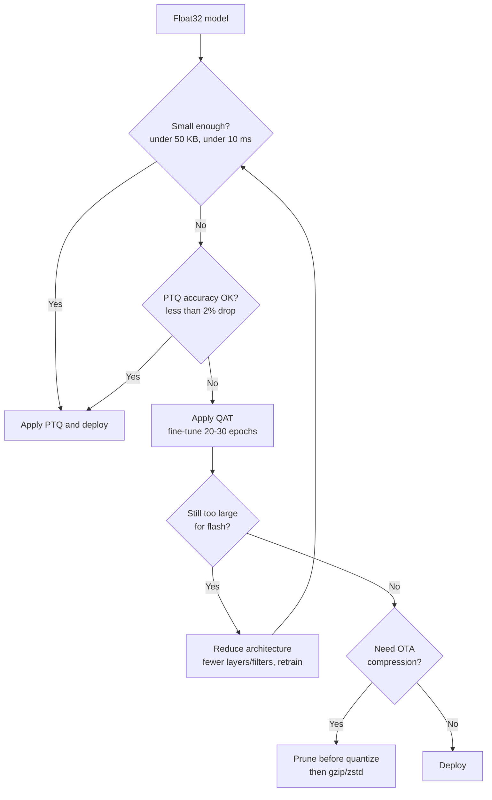

import TawkWidget from '../../../../components/TawkWidget.astro';
import UniversalContentContributors from '../../../../components/UniversalContentContributors.astro';
import InArticleAd from '../../../../components/InArticleAd.astro';
import Copyright from '../../../../components/Copyright.astro';
import BionicText from '../../../../components/BionicText.astro';
import TailwindWrapper from '../../../../components/TailwindWrapper.jsx';
import { Tabs, TabItem } from '@astrojs/starlight/components';
import { Card, CardGrid, Badge, Steps, LinkButton, FileTree } from '@astrojs/starlight/components';

<UniversalContentContributors 
  contributors={frontmatter.contributors}
/>


import EdgeAiTinymlComments from '../../../../components/edge-ai-tinyml/EdgeAiTinymlComments.astro';

import PodcastEmbed from '../../../../components/PodcastEmbed.astro';

A model that classifies well on your laptop can be four times too large for the flash of a microcontroller and several times too slow on it. The cause is the way its numbers are stored: 32-bit floating-point values, 4 bytes each. Quantization stores every weight, and every result between layers, as an 8-bit integer. The model shrinks and runs faster, and it loses a little accuracy because every number is rounded. This lesson shows how the rounding works and what it costs. You quantize a gesture classifier in two ways, after training (post-training quantization, PTQ) and during training (quantization-aware training, QAT), run each version on an ESP32, and compare size, speed and accuracy. #Quantization #TinyML #ModelOptimization

<PodcastEmbed src="https://open.spotify.com/episode/0helatWKSTmQkwtEmUGfcl?si=zONVcLp-Siaa8F09Ek9UmA" />

## Why Quantization Matters

### Float32 vs Int8 on a Cortex-M / Xtensa MCU

Inference is mostly one action repeated many thousands of times: multiply an input by a weight and add the product to a sum. With float32 numbers this takes 3 to 5 clock cycles on a Cortex-M4 that has a floating-point unit (FPU), and 10 to 20 cycles without one. With int8 numbers, one DSP instruction (SMLAD) does two of these multiply-and-add actions in a single cycle, once the 8-bit values have been widened to 16 bits. The ESP32 gains in a similar way through the esp-nn library.

| Property | Float32 | Int8 |
|----------|---------|------|
| Bytes per weight | 4 | 1 |
| Model size (relative) | 1x | 0.25x to 0.4x |
| Inference speed (relative) | 1x | 2x to 4x faster |
| RAM for activations | 1x | ~0.25x |
| Accuracy | Baseline | Slight decrease (0.5% to 3% typical) |
| Hardware acceleration | FPU only | CMSIS-NN / esp-nn |

The weights always shrink four times, because 4 bytes become 1. The speed gain appears only if optimized int8 routines exist for your chip.

```text
  ┌────────┐    Quantize     ┌────────┐
  │ 0.352  │  ──────────►    │  44    │
  │-0.128  │   scale=0.008   │ -16    │
  │ 1.016  │   zp=0          │ 127    │
  └────────┘                 └────────┘
   4 bytes                    1 byte
   per value                  per value
```

### How Quantization Works

Think of a ruler with 256 marks laid over the range of the values. Each value moves to the nearest mark, and the chip stores only the number of the mark. Two numbers describe the ruler. The **scale** is the distance between two marks. The **zero point** (zp) is the mark that stands for 0.0.

```
float_value = (int8_value - zero_point) * scale
int8_value  = round(float_value / scale) + zero_point
```

In the drawing, 0.352 / 0.008 = 44. A weight of 0.355 also becomes 44 and returns as 0.352. That difference of 0.003 is the rounding error, and it is never more than half a scale, here 0.004.

An int8 holds the values -128 to 127. Activations (the results between layers) use that full range, with the zero point placed where it fits. For weights, TFLite fixes the zero point at 0 and uses only -127 to 127, which is 255 levels, so that the range is equal on both sides of zero. This is why the largest weight in the drawing, 1.016, maps to 127 with a scale of 1.016 / 127 = 0.008.

The converter chooses a scale and zero point for each tensor, and for the weights of a convolution it chooses a scale for each filter (per-channel quantization).

<Card title="Representative Dataset" icon="star">
The converter can read the weights from the model, so it knows their range. It cannot know the range of the activations without running real inputs. The representative dataset is a small batch of real input data (100 to 500 samples) that the converter passes through the model to observe the range at each layer. From those ranges it sets each scale and zero point.
</Card>

There are two ways to reach the int8 model. PTQ converts a finished model and needs no more training. QAT trains the model further while it imitates the 8-bit rounding, so the model adjusts to it.

## The Quantization Benchmark Project

<InArticleAd />


We classify the same accelerometer gestures as in the lesson on [model deployment with TFLite Micro](/education/edge-ai-tinyml/tensorflow-lite-micro-model-deployment/), this time with a 1D convolutional neural network (CNN). A convolutional layer slides a small set of weights, called a filter, along the time axis, so it finds a short pattern wherever it occurs in the window. The CNN does more arithmetic than the fully connected model, so the effect of quantization is easier to measure.

### Dataset

We reuse the gesture recordings (wave, punch, flex): 50 samples per recording at 50 Hz, so one 1-second window holds 150 values.

## Step 1: Train the Float32 Baseline Model

<InArticleAd />


The QAT and pruning steps use the TensorFlow Model Optimization Toolkit (`tfmot`), which works only with the older Keras 2 (`tf_keras`). TensorFlow 2.16 and later use Keras 3, and a model saved by Keras 3 cannot be loaded by `tfmot`. So install both packages and run every script of this lesson with Keras 2, from the first one:

```bash
pip install tensorflow tf_keras tensorflow-model-optimization
export TF_USE_LEGACY_KERAS=1   # Windows: set TF_USE_LEGACY_KERAS=1
```

```python
# train_cnn_gesture.py
# Train a 1D CNN gesture classifier (float32 baseline)

import os
import numpy as np
import tensorflow as tf
from sklearn.model_selection import train_test_split

# Load data (same as Lesson 3)
classes = ['wave', 'punch', 'flex']
X_all, y_all = [], []

for class_idx, class_name in enumerate(classes):
    data_dir = f"data/{class_name}/"
    for filename in sorted(os.listdir(data_dir)):
        if filename.endswith('.npy'):
            sample = np.load(os.path.join(data_dir, filename))
            if len(sample) > 50:
                sample = sample[:50]
            elif len(sample) < 50:
                pad = np.zeros((50 - len(sample), 3), dtype=np.float32)
                sample = np.vstack([sample, pad])
            X_all.append(sample)  # Keep as (50, 3) for CNN
            y_all.append(class_idx)

X_all = np.array(X_all, dtype=np.float32)  # shape: (N, 50, 3)
y_all = np.array(y_all, dtype=np.int32)

# Normalize to [0, 1]
# The MPU6050 is set to +/- 2 g. Use this fixed range in every script
# and in the firmware, so that the preprocessing is always the same.
X_min, X_max = -2.0, 2.0
X_all = (X_all - X_min) / (X_max - X_min)

print(f"Dataset: {X_all.shape[0]} samples, shape per sample: {X_all.shape[1:]}")

X_train, X_test, y_train, y_test = train_test_split(
    X_all, y_all, test_size=0.2, random_state=42, stratify=y_all
)
# Keep the test recordings, so every later script tests on the same unseen set
np.savez('test_split.npz', X_test=X_test, y_test=y_test)

y_train_oh = tf.keras.utils.to_categorical(y_train, num_classes=len(classes))
y_test_oh = tf.keras.utils.to_categorical(y_test, num_classes=len(classes))

# 1D CNN model
model = tf.keras.Sequential([
    # Input: (50, 3) - 50 time steps, 3 axes. Reshaped to (50, 1, 3) so
    # each 1D convolution is a Conv2D with a (5, 1) or (3, 1) filter: the
    # same 12,195 parameters, and the QAT toolkit supports Conv2D, not Conv1D
    tf.keras.layers.Reshape((50, 1, 3), input_shape=(50, 3)),
    tf.keras.layers.Conv2D(16, kernel_size=(5, 1), activation='relu'),
    tf.keras.layers.MaxPooling2D(pool_size=(2, 1)),
    tf.keras.layers.Conv2D(32, kernel_size=(3, 1), activation='relu'),
    tf.keras.layers.MaxPooling2D(pool_size=(2, 1)),
    tf.keras.layers.Flatten(),
    tf.keras.layers.Dense(32, activation='relu'),
    tf.keras.layers.Dropout(0.3),
    tf.keras.layers.Dense(len(classes), activation='softmax')
])

model.compile(
    optimizer='adam',
    loss='categorical_crossentropy',
    metrics=['accuracy']
)

model.summary()

# Train
history = model.fit(
    X_train, y_train_oh,
    epochs=80,
    batch_size=16,
    validation_data=(X_test, y_test_oh),
    verbose=1
)

# Evaluate
loss, accuracy = model.evaluate(X_test, y_test_oh, verbose=0)
print(f"\nFloat32 model test accuracy: {accuracy:.4f}")

# Save
model.save('gesture_cnn_float32.keras')

# Also export float32 TFLite (for comparison)
converter_f32 = tf.lite.TFLiteConverter.from_keras_model(model)
tflite_f32 = converter_f32.convert()
with open('gesture_cnn_float32.tflite', 'wb') as f:
    f.write(tflite_f32)
print(f"Float32 TFLite size: {len(tflite_f32)} bytes")
```

Record the baseline values that the script prints. The parameter count is exact, the file size was measured (TensorFlow 2.21 with Keras 2), and the accuracy depends on your recordings:

| Metric | Value |
|--------|-------|
| Parameters | 12,195 |
| Float32 .tflite size | about 53 KB (53,480 bytes) |
| Test accuracy | ~94% to 97% |

## Step 2: Post-Training Quantization (PTQ)

<InArticleAd />


Post-training quantization takes the trained float32 model and converts its weights and activations to int8. It is the easier way, because the model is not trained again. The script converts the model and then measures the accuracy of the int8 version on the test recordings.

```python
# ptq_convert.py
# Post-training quantization of the CNN gesture model

import os
import numpy as np
import tensorflow as tf

# Load the trained float32 model
model = tf.keras.models.load_model('gesture_cnn_float32.keras')

# Load training data for representative dataset
# (same loading code as above, abbreviated)
classes = ['wave', 'punch', 'flex']
X_train_samples = []
for class_name in classes:
    data_dir = f"data/{class_name}/"
    for filename in sorted(os.listdir(data_dir))[:40]:
        if filename.endswith('.npy'):
            sample = np.load(os.path.join(data_dir, filename))
            if len(sample) > 50:
                sample = sample[:50]
            elif len(sample) < 50:
                pad = np.zeros((50 - len(sample), 3), dtype=np.float32)
                sample = np.vstack([sample, pad])
            X_train_samples.append(sample)

X_repr = np.array(X_train_samples, dtype=np.float32)
X_min, X_max = -2.0, 2.0  # Same fixed range as in training
X_repr = (X_repr - X_min) / (X_max - X_min)

def representative_dataset():
    for i in range(len(X_repr)):
        yield [X_repr[i:i+1].astype(np.float32)]

# Full integer quantization
converter = tf.lite.TFLiteConverter.from_keras_model(model)
converter.optimizations = [tf.lite.Optimize.DEFAULT]
converter.representative_dataset = representative_dataset
converter.target_spec.supported_ops = [tf.lite.OpsSet.TFLITE_BUILTINS_INT8]
converter.inference_input_type = tf.int8
converter.inference_output_type = tf.int8

tflite_int8_ptq = converter.convert()

with open('gesture_cnn_int8_ptq.tflite', 'wb') as f:
    f.write(tflite_int8_ptq)

print(f"PTQ int8 TFLite size: {len(tflite_int8_ptq)} bytes")

# Evaluate PTQ model accuracy
interpreter = tf.lite.Interpreter(model_content=tflite_int8_ptq)
interpreter.allocate_tensors()
input_details = interpreter.get_input_details()
output_details = interpreter.get_output_details()

input_scale = input_details[0]['quantization'][0]
input_zp = input_details[0]['quantization'][1]

# Load the test split saved by train_cnn_gesture.py (already normalized).
# The last 20% of the files would not do: the split was random, so most
# of them were used in training and would make the accuracy look better
d = np.load('test_split.npz')
X_test_all, y_test_all = d['X_test'], d['y_test']

correct = 0
for i in range(len(X_test_all)):
    # clip: a value beyond the range the converter saw would wrap around
    x_q = np.clip(np.round(X_test_all[i] / input_scale + input_zp), -128, 127).astype(np.int8)
    interpreter.set_tensor(input_details[0]['index'], x_q.reshape(1, 50, 3))
    interpreter.invoke()
    output = interpreter.get_tensor(output_details[0]['index'])[0]
    if np.argmax(output) == y_test_all[i]:
        correct += 1

ptq_accuracy = correct / len(X_test_all)
print(f"PTQ int8 test accuracy: {ptq_accuracy:.4f}")
```

## Step 3: Quantization-Aware Training (QAT)

<InArticleAd />


In QAT the model trains for a few more passes through the data. During that training every weight and every layer output is rounded to its 8-bit level before it is used. These rounding steps are called fake quantization, because the numbers are still stored as float32. The adjustments to the weights are also computed in float32. The model therefore settles on weights that still give the right answer after rounding. Install the toolkit first with the `pip` command below the script.

```python
# qat_train.py
# Quantization-aware training for the CNN gesture model

import os
import numpy as np
import tensorflow as tf
import tensorflow_model_optimization as tfmot

# Load the pre-trained float32 model
model = tf.keras.models.load_model('gesture_cnn_float32.keras')

# Apply quantization-aware training wrapper
quantize_model = tfmot.quantization.keras.quantize_model
qat_model = quantize_model(model)

qat_model.compile(
    optimizer=tf.keras.optimizers.Adam(learning_rate=0.0001),  # Lower LR for fine-tuning
    loss='categorical_crossentropy',
    metrics=['accuracy']
)

qat_model.summary()

# Load training data (same as before)
classes = ['wave', 'punch', 'flex']
X_all, y_all = [], []
for class_idx, class_name in enumerate(classes):
    data_dir = f"data/{class_name}/"
    for filename in sorted(os.listdir(data_dir)):
        if filename.endswith('.npy'):
            sample = np.load(os.path.join(data_dir, filename))
            if len(sample) > 50: sample = sample[:50]
            elif len(sample) < 50:
                sample = np.vstack([sample, np.zeros((50 - len(sample), 3))])
            X_all.append(sample)
            y_all.append(class_idx)

X_all = np.array(X_all, dtype=np.float32)
y_all = np.array(y_all, dtype=np.int32)
X_min, X_max = -2.0, 2.0  # Same fixed range as in training
X_all = (X_all - X_min) / (X_max - X_min)

from sklearn.model_selection import train_test_split
X_train, X_test, y_train, y_test = train_test_split(
    X_all, y_all, test_size=0.2, random_state=42, stratify=y_all
)
y_train_oh = tf.keras.utils.to_categorical(y_train, num_classes=len(classes))
y_test_oh = tf.keras.utils.to_categorical(y_test, num_classes=len(classes))

# Fine-tune with QAT (fewer epochs, lower learning rate)
history = qat_model.fit(
    X_train, y_train_oh,
    epochs=30,
    batch_size=16,
    validation_data=(X_test, y_test_oh),
    verbose=1
)

# Evaluate QAT model (still float32 internally, but simulating quantization)
loss, accuracy = qat_model.evaluate(X_test, y_test_oh, verbose=0)
print(f"QAT model (simulated quantization) accuracy: {accuracy:.4f}")

# Convert QAT model to int8 TFLite
converter = tf.lite.TFLiteConverter.from_keras_model(qat_model)
converter.optimizations = [tf.lite.Optimize.DEFAULT]

# QAT models already have quantization ranges embedded,
# so representative_dataset is optional but still helpful
def representative_dataset():
    for i in range(min(100, len(X_train))):
        yield [X_train[i:i+1].astype(np.float32)]

converter.representative_dataset = representative_dataset
converter.target_spec.supported_ops = [tf.lite.OpsSet.TFLITE_BUILTINS_INT8]
converter.inference_input_type = tf.int8
converter.inference_output_type = tf.int8

tflite_int8_qat = converter.convert()

with open('gesture_cnn_int8_qat.tflite', 'wb') as f:
    f.write(tflite_int8_qat)

print(f"QAT int8 TFLite size: {len(tflite_int8_qat)} bytes")
```

The toolkit was installed in Step 1 (`pip install tensorflow-model-optimization`); without `TF_USE_LEGACY_KERAS=1` the first line that loads the model fails.

### PTQ vs QAT: When to Use Which

| Aspect | Post-Training Quantization | Quantization-Aware Training |
|--------|---------------------------|----------------------------|
| Effort | Minimal (no retraining) | Moderate (fine-tune 20 to 30 epochs) |
| Accuracy loss | 0.5% to 3% typical | 0.1% to 0.5% typical |
| Best for | Simple models, large datasets | Complex models, tight accuracy requirements |
| Requires | Representative dataset (100+ samples) | Full training pipeline + `tfmot` library |
| Model size | Same as QAT (both are int8) | Same as PTQ (both are int8) |

For simple fully connected models, such as the sine predictor at the start of this course, PTQ is almost always enough. For deeper CNNs, and where each percentage point of accuracy matters, QAT is worth the extra work.

## Step 4: Deploy Both Models on ESP32

<InArticleAd />


Convert the `.tflite` files to C arrays, write a header for each as you did for the gesture model, and build one firmware image for each. The firmware measures time and memory only: it runs one fixed input 100 times. The accuracy values come from the Python scripts.

```bash
xxd -i gesture_cnn_int8_ptq.tflite > gesture_ptq_data.cc
xxd -i gesture_cnn_int8_qat.tflite > gesture_qat_data.cc
xxd -i gesture_cnn_float32.tflite > gesture_f32_data.cc
```

### Benchmark Firmware

```cpp
// main/benchmark.cc
// Benchmark float32 vs int8 PTQ vs int8 QAT on ESP32

#include <cstdio>
#include <cstdint>
#include <cmath>
#include "freertos/FreeRTOS.h"
#include "freertos/task.h"
#include "esp_timer.h"
#include "esp_log.h"
#include "esp_system.h"
#include "esp_heap_caps.h"

#include "tensorflow/lite/micro/micro_mutable_op_resolver.h"
#include "tensorflow/lite/micro/micro_interpreter.h"
#include "tensorflow/lite/micro/schema/schema_generated.h"  // older TFLM: tensorflow/lite/schema/

// Include the model you want to benchmark
// Uncomment one at a time, change the array name in GetModel() to match, and rebuild
#include "gesture_ptq_data.h"
// #include "gesture_qat_data.h"
// #include "gesture_f32_data.h"

static const char *TAG = "benchmark";

constexpr int kArenaSize = 32 * 1024;  // Start large, measure actual
alignas(16) static uint8_t tensor_arena[kArenaSize];

// Synthetic test data (50 time steps, 3 axes, normalized to [0,1])
// In production, replace with real sensor data
static float test_inputs[][150] = {
    // Sample 0: simulated "wave" pattern (oscillating X axis)
    {0.3f, 0.5f, 0.5f, 0.7f, 0.5f, 0.5f, 0.3f, 0.5f, 0.5f, 0.7f,
     0.5f, 0.5f, 0.3f, 0.5f, 0.5f, 0.7f, 0.5f, 0.5f, 0.3f, 0.5f,
     // ... (remaining values for a full 150-element array)
     0.5f, 0.5f, 0.5f, 0.5f, 0.5f, 0.5f, 0.5f, 0.5f, 0.5f, 0.5f,
     0.5f, 0.5f, 0.5f, 0.5f, 0.5f, 0.5f, 0.5f, 0.5f, 0.5f, 0.5f,
     0.5f, 0.5f, 0.5f, 0.5f, 0.5f, 0.5f, 0.5f, 0.5f, 0.5f, 0.5f,
     0.5f, 0.5f, 0.5f, 0.5f, 0.5f, 0.5f, 0.5f, 0.5f, 0.5f, 0.5f,
     0.5f, 0.5f, 0.5f, 0.5f, 0.5f, 0.5f, 0.5f, 0.5f, 0.5f, 0.5f,
     0.5f, 0.5f, 0.5f, 0.5f, 0.5f, 0.5f, 0.5f, 0.5f, 0.5f, 0.5f,
     0.5f, 0.5f, 0.5f, 0.5f, 0.5f, 0.5f, 0.5f, 0.5f, 0.5f, 0.5f,
     0.5f, 0.5f, 0.5f, 0.5f, 0.5f, 0.5f, 0.5f, 0.5f, 0.5f, 0.5f,
     0.5f, 0.5f, 0.5f, 0.5f, 0.5f, 0.5f, 0.5f, 0.5f, 0.5f, 0.5f,
     0.5f, 0.5f, 0.5f, 0.5f, 0.5f, 0.5f, 0.5f, 0.5f, 0.5f, 0.5f,
     0.5f, 0.5f, 0.5f, 0.5f, 0.5f, 0.5f, 0.5f, 0.5f, 0.5f, 0.5f},
};

extern "C" void app_main(void) {
    ESP_LOGI(TAG, "=== Quantization Benchmark ===");
    ESP_LOGI(TAG, "Free heap: %lu bytes", esp_get_free_heap_size());

    // Load model
    const tflite::Model *model = tflite::GetModel(gesture_cnn_int8_ptq_tflite);
    if (model->version() != TFLITE_SCHEMA_VERSION) {
        ESP_LOGE(TAG, "Schema mismatch");
        return;
    }

    // Register ops for the CNN model. With the Conv2D form, TensorFlow 2.21
    // produced CONV_2D, MAX_POOL_2D, RESHAPE, SHAPE, STRIDED_SLICE, PACK,
    // FULLY_CONNECTED and SOFTMAX (ReLU is fused); a Conv1D model also
    // needs EXPAND_DIMS and SQUEEZE
    static tflite::MicroMutableOpResolver<10> resolver;
    resolver.AddConv2D();         // Conv1D is implemented as Conv2D internally
    resolver.AddMaxPool2D();      // MaxPool1D is implemented as MaxPool2D
    // The converter adds a dimension before each Conv2D/MaxPool2D and
    // removes it after. Depending on the TensorFlow version these are
    // EXPAND_DIMS and SQUEEZE ops or RESHAPE ops, so register all three.
    resolver.AddExpandDims();
    resolver.AddSqueeze();
    resolver.AddReshape();
    // Flatten computes its output shape at run time with these three
    resolver.AddShape();
    resolver.AddStridedSlice();
    resolver.AddPack();
    resolver.AddFullyConnected();
    resolver.AddSoftmax();

    static tflite::MicroInterpreter interpreter(model, resolver,
                                                 tensor_arena, kArenaSize);
    if (interpreter.AllocateTensors() != kTfLiteOk) {
        ESP_LOGE(TAG, "AllocateTensors failed");
        return;
    }

    TfLiteTensor *input = interpreter.input(0);
    TfLiteTensor *output = interpreter.output(0);

    size_t arena_used = interpreter.arena_used_bytes();
    ESP_LOGI(TAG, "Arena used: %zu / %d bytes", arena_used, kArenaSize);
    ESP_LOGI(TAG, "Input type: %d, Output type: %d", input->type, output->type);

    // Run benchmark: 100 inferences
    const int NUM_RUNS = 100;
    int64_t total_us = 0;
    int64_t min_us = INT64_MAX;
    int64_t max_us = 0;

    for (int run = 0; run < NUM_RUNS; run++) {
        // Prepare input (quantize if int8)
        if (input->type == kTfLiteInt8) {
            float scale = input->params.scale;
            int32_t zp = input->params.zero_point;
            for (int i = 0; i < 150; i++) {
                float val = test_inputs[0][i];
                int32_t q = (int32_t)roundf(val / scale) + zp;
                if (q < -128) q = -128;
                if (q > 127) q = 127;
                input->data.int8[i] = (int8_t)q;
            }
        } else {
            // Float32
            for (int i = 0; i < 150; i++) {
                input->data.f[i] = test_inputs[0][i];
            }
        }

        int64_t t0 = esp_timer_get_time();
        if (interpreter.Invoke() != kTfLiteOk) {
            ESP_LOGE(TAG, "Invoke failed");
            return;
        }
        int64_t t1 = esp_timer_get_time();

        int64_t elapsed = t1 - t0;
        total_us += elapsed;
        if (elapsed < min_us) min_us = elapsed;
        if (elapsed > max_us) max_us = elapsed;
    }

    ESP_LOGI(TAG, "");
    ESP_LOGI(TAG, "=== Results (%d runs) ===", NUM_RUNS);
    ESP_LOGI(TAG, "Average inference: %lld us", total_us / NUM_RUNS);
    ESP_LOGI(TAG, "Min inference:     %lld us", min_us);
    ESP_LOGI(TAG, "Max inference:     %lld us", max_us);
    ESP_LOGI(TAG, "Arena used:        %zu bytes", arena_used);
    ESP_LOGI(TAG, "Free heap after:   %lu bytes", esp_get_free_heap_size());

    // Print output for the last run
    if (output->type == kTfLiteInt8) {
        float scale = output->params.scale;
        int32_t zp = output->params.zero_point;
        ESP_LOGI(TAG, "Output scores (dequantized):");
        const char *labels[] = {"wave", "punch", "flex"};
        for (int c = 0; c < 3; c++) {
            float score = (output->data.int8[c] - zp) * scale;
            ESP_LOGI(TAG, "  %s: %.4f", labels[c], score);
        }
    }

    while (1) {
        vTaskDelay(pdMS_TO_TICKS(10000));
    }
}
```

Build and flash three times (once per model variant) and record the results.

To check that the chip computes what the PC computed, run the same `test_inputs` array through the int8 interpreter in Python and compare the three scores with the firmware's "Output scores" lines: they should agree within one output step (about 0.004).

## Step 5: Benchmark Comparison

<InArticleAd />


Run each model variant on the same ESP32 and record what it prints. The table shows the kind of result to expect. Its file sizes were measured on a PC; its other values are examples, not measurements made for this lesson:

| Metric | Float32 | Int8 PTQ | Int8 QAT |
|--------|---------|----------|----------|
| .tflite file size | 53,480 bytes | 19,656 bytes | 19,392 bytes |
| Tensor arena used | ~12 KB | ~4 KB | ~4 KB |
| Avg inference time | ~3 ms | ~0.8 ms | ~0.8 ms |
| Test accuracy | 95.5% | 93.2% | 95.0% |
| Flash used (total firmware) | ~420 KB | ~400 KB | ~400 KB |

What the table shows:

1. Size. The int8 file is about 2.7 times smaller than float32. The weights shrink exactly four times ($12195 \times 4 = 48780$ bytes become 12195 bytes), but the description of the layers does not shrink, and the int8 file adds a scale for every filter and a 32-bit bias for every unit.

2. Speed. The int8 model runs 3 to 4 times faster, because TFLM uses optimized int8 routines (esp-nn on Xtensa, CMSIS-NN on Cortex-M).

3. Accuracy. PTQ loses about 2 percentage points. QAT recovers most of that loss and comes within 0.5 points of the float32 baseline.

4. PTQ and QAT give the same size and speed, because both produce int8 models. They differ only in accuracy.

## Representative Dataset: Getting It Right

<InArticleAd />


In PTQ the representative dataset decides the ranges, so it decides the quality of the result. If it lacks the large values that real inputs produce, the ranges are set too narrow. Real values are then cut off at the ends of the range (clipped), and accuracy falls.

### Rules for representative datasets:

<Steps>
1. **Use real training data, not synthetic data.** The representative dataset must reflect the actual distribution of inputs the model will see.

2. **Include all classes.** If your dataset has 3 classes, the representative batch should contain samples from all 3.

3. **Use at least 100 samples.** The converter needs enough samples to estimate the activation range at each layer reliably.

4. **Do not use the test set.** Use a subset of the training data. The test set should remain unseen for evaluation.

5. **Match the preprocessing.** If your training pipeline normalizes to [0, 1], the representative data must also be normalized to [0, 1].
</Steps>

```python
# Good: diverse, real, preprocessed correctly
def representative_dataset():
    indices = np.random.choice(len(X_train), size=200, replace=False)
    for i in indices:
        yield [X_train[i:i+1].astype(np.float32)]

# Bad: only one class represented
def bad_representative_dataset():
    for i in range(100):
        yield [X_train_wave_only[i:i+1].astype(np.float32)]
```

## Model Pruning Basics

<InArticleAd />


Quantization reduces the precision of the weights. Pruning removes weights by setting the smallest ones to zero. The pruned model has the same layers, but many of its weights are zero, and a file with long runs of zeros compresses well.

### Structured vs Unstructured Pruning

| Type | What gets removed | Benefit | Tooling |
|------|-------------------|---------|---------|
| Unstructured | Individual weights (scattered zeros) | High compression with gzip/zstd | `tfmot.sparsity.keras.prune_low_magnitude` |
| Structured | Entire filters or neurons | Real speed gain (fewer operations) | Manual or research tools |

Unstructured pruning is the practical one for a microcontroller, because the tool exists. Pruning, quantization and gzip together can make the file 5 to 10 times smaller than the float32 baseline. The interpreter reads the model uncompressed, so this gain is for sending an update over the air (OTA), not for the flash that the running model occupies.

```python
# pruning_example.py
# Apply unstructured pruning to the gesture CNN

import numpy as np
import tensorflow as tf
import tensorflow_model_optimization as tfmot

model = tf.keras.models.load_model('gesture_cnn_float32.keras')

# X_train, y_train_oh, X_test, y_test_oh and representative_dataset:
# load and define them exactly as in qat_train.py

# The schedule must end when training ends, or the final sparsity is
# never reached: total steps = batches per epoch x epochs
end_step = int(np.ceil(len(X_train) / 16)) * 20

# Define pruning schedule: start at 30% sparsity, end at 70%
pruning_params = {
    'pruning_schedule': tfmot.sparsity.keras.PolynomialDecay(
        initial_sparsity=0.30,
        final_sparsity=0.70,
        begin_step=0,
        end_step=end_step
    )
}

pruned_model = tfmot.sparsity.keras.prune_low_magnitude(model, **pruning_params)

pruned_model.compile(
    optimizer='adam',
    loss='categorical_crossentropy',
    metrics=['accuracy']
)

# Fine-tune with pruning callbacks
callbacks = [tfmot.sparsity.keras.UpdatePruningStep()]

pruned_model.fit(
    X_train, y_train_oh,
    epochs=20,
    batch_size=16,
    validation_data=(X_test, y_test_oh),
    callbacks=callbacks,
    verbose=1
)

# Strip pruning wrappers for export
stripped_model = tfmot.sparsity.keras.strip_pruning(pruned_model)

# Convert pruned model to int8 TFLite (quantization + pruning combined)
converter = tf.lite.TFLiteConverter.from_keras_model(stripped_model)
converter.optimizations = [tf.lite.Optimize.DEFAULT]
converter.representative_dataset = representative_dataset
converter.target_spec.supported_ops = [tf.lite.OpsSet.TFLITE_BUILTINS_INT8]
converter.inference_input_type = tf.int8
converter.inference_output_type = tf.int8

tflite_pruned = converter.convert()

with open('gesture_cnn_pruned_int8.tflite', 'wb') as f:
    f.write(tflite_pruned)

print(f"Pruned + quantized TFLite size: {len(tflite_pruned)} bytes")

# Compressed size (shows the benefit of sparsity)
import gzip
compressed = gzip.compress(tflite_pruned)
print(f"Compressed size: {len(compressed)} bytes")
print(f"Compression ratio: {len(tflite_pruned) / len(compressed):.1f}x")
```

:::note
Unstructured pruning does not reduce inference time on TFLM, because the runtime still multiplies by every weight, including the zeros. For a real speed gain you need structured pruning or a smaller model.
:::

## Best Practices for MCU Model Optimization

<InArticleAd />


<CardGrid>
  <Card title="Start with the smallest model that works" icon="star">
  Do not train a large model and then try to compress it. Start with a small one (2 layers, 16 to 32 neurons) and enlarge it only if the accuracy is too low.
  </Card>

  <Card title="Always use int8 quantization" icon="star">
  There is almost no reason to run float32 on an MCU. The model becomes 2.5 to 4 times smaller and faster for a small loss of accuracy. Use PTQ for simple models and QAT for complex ones.
  </Card>

  <Card title="Profile before optimizing" icon="star">
  Measure with `interpreter.arena_used_bytes()` and `esp_timer_get_time()`. Do not guess. A model that uses 8 KB of arena does not need a 32 KB array.
  </Card>

  <Card title="Match preprocessing exactly" icon="star">
  The most common deployment fault is preprocessing in the firmware that differs from the preprocessing in training. If you normalize to [0, 1] during training, the firmware must apply the same normalization with the same min/max values before quantizing the input.
  </Card>
</CardGrid>

## Summary: Optimization Decision Tree

<InArticleAd />




<Steps>
1. **Is the float32 model already small enough?** (Under 50 KB, inference under 10 ms.) If yes, apply PTQ and deploy. You are done.

2. **Does PTQ accuracy meet requirements?** Run PTQ and check. If accuracy drops less than 2%, use PTQ.

3. **Is the accuracy drop too large with PTQ?** Apply QAT. Fine-tune for 20 to 30 epochs with a low learning rate.

4. **Is the model still too large for flash?** Reduce the architecture (fewer layers, fewer filters). Retrain from scratch.

5. **Need further compression for storage (OTA updates)?** Apply pruning before quantization, then compress the .tflite with gzip/zstd.
</Steps>

:::tip[Instrument it]
An int8 model of a few kilobytes fits a low-cost microcontroller placed beside the sensor and powered by a small battery. The float32 model may need a larger board with mains power. With the model on the device, only the [detection leaves the device](/education/iot-systems/) for [siliconwit.io](https://siliconwit.io), and the raw signal stays where it was measured.
:::

## Exercises

<InArticleAd />


<CardGrid>
  <Card title="Exercise 1: Dynamic Range Quantization" icon="pencil">
  Convert the model using dynamic range quantization (weights only, activations stay float32). Compare the resulting model size and inference speed against full int8 quantization. On which platforms does this approach make sense?
  </Card>

  <Card title="Exercise 2: Per-Channel vs Per-Tensor" icon="pencil">
  The TFLite converter supports per-channel quantization for Conv layers (each filter gets its own scale/zp). Compare per-channel vs per-tensor quantization accuracy on the CNN model. Which one does the converter use by default?
  </Card>

  <Card title="Exercise 3: Pruning Sparsity Sweep" icon="pencil">
  Run the pruning experiment at 50%, 70%, and 90% final sparsity. For each level, measure test accuracy, .tflite size, and gzip-compressed size. Plot the trade-off curve.
  </Card>

  <Card title="Exercise 4: STM32 Benchmark" icon="pencil">
  Deploy the float32, PTQ, and QAT models on an STM32F4 and repeat the benchmark. Compare the speedup ratio between platforms. Does Cortex-M4 benefit more or less from int8 quantization than Xtensa?
  </Card>
</CardGrid>

## What Comes Next

<InArticleAd />


Next you use these methods in a wake word detector. An ESP32 with a digital microphone listens for one spoken word, turns the sound into features, and runs a quantized model on them.

<EdgeAiTinymlComments />


<InArticleAd />
<TawkWidget />
<Copyright />
